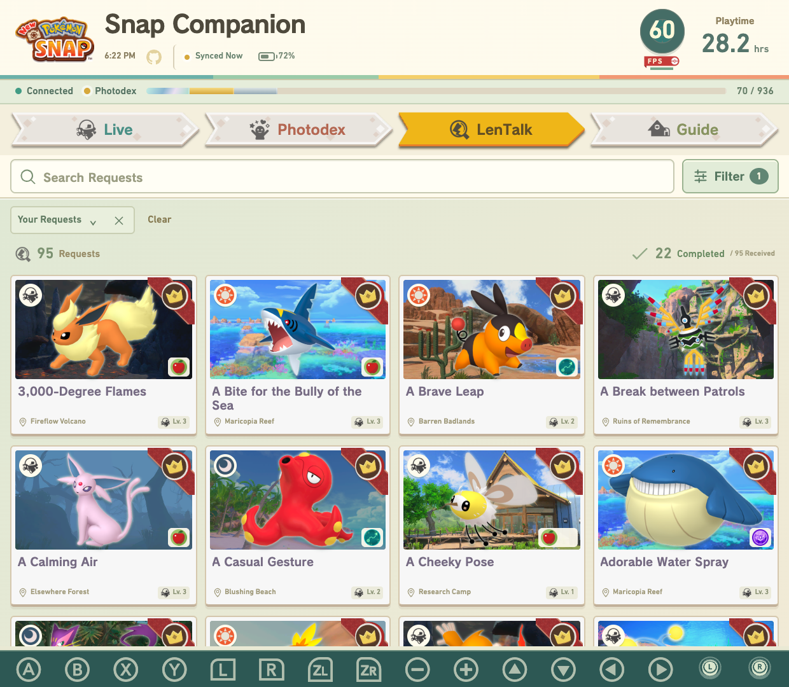

# Snap Companion

[](https://github.com/gbppimentel-dev/snap-companion/releases/latest)
[](https://github.com/gbppimentel-dev/snap-companion/actions/workflows/ci.yml)
[](LICENSE)

A second-screen companion for **New Pokémon Snap on AYN Thor**, running through Eden. Keep your Photodex, LenTalk requests and illustrated course map on the bottom screen while playing above. Everything runs locally, including offline.

**Current development APK:0.5.30-dev.5 / code51.** Map zoom survives temporary course-reading gaps, and high-resolution portrait pins render in an unscaled overlay. Research Camp has its own verified live scene/camera path and a native photos-left counter checked through a shot and retry. Standard courses can now resolve the same typed counter through the game’s named HUD registry; this ownership path was checked in Park Day. Startup resume waits for a recognized game context. It updates the original `dev.gbppimentel.snapcompanion` package with the same signer and private data. No separate Next app or Eden Duo mod is required. The published [v0.5.24 release](docs/releases/v0.5.24.md) is a historical baseline; its APK, tag and backups are preserved. Development APKs are built locally and are not automatically published to GitHub.

## Features

- **Live:** verified game-memory course/variant, selected research level, measured route position and render-camera view. The header shows available Eden-reported FPS, Cocoon-recorded Thor playtime, clock and sync status. Passive controller feedback remains available.
- **Course map:** expand from Live or Guide. All30 illustrations,143 terrain/route assets,1,403 authored locations and123 known NEO-ONE rails are bundled. Pan, pinch/zoom, Overview and Follow; Follow starts enabled and yields to its toggle or map gestures. Separate All Pokémon, Missing Diamonds, LenTalk and Hidden modes avoid intersecting unrelated filters.
- **Route progress:** a yellow measured trail, named section progress and current-path course progress account for known forks and rejoins. A guarded cone follows the real camera and lens. There is no separate tracker tab or map photography-tool bar.
- **Photodex:** automatic supported saved-photo registration, scores, medals and images; four current categories across234 Pokémon, with a936-Diamond goal.
- **LenTalk:** supported received/completed statuses, illustrated request cards, full offline solutions and reward references.
- **Photo Selection:** currently recognized subject/category alongside saved benchmarks, missing stars and points needed for Diamond. It does not rank ungraded shots. There is no dedicated grading helper.
- **Guide:** course encounters, collection coverage, four-category photo tips and named form/gender reference artwork.
- **Credits:** compact creator/contributor acknowledgements from the header button.

## What is verified and what remains

The direct reader supports the exact owned New Pokémon Snap2.0.1 build on the checked Thor/Eden environment. Course and selected-level readings do not depend on English screen labels when that reader is available. Saved research progress and reference filters never substitute for the current selected run. English OCR remains a provider for supported screen-only observations, including Photo Selection; not every field has a memory provider.

Schematic alignments cover **portions of30 illustrations /121 of123 known rails**. These counts are not full gameplay acceptance: rejected intervals remain hidden, two short rails remain unplaced, and other Forest seasons/branches need evidence. Forest/Camp whole-course progress remains neutral until their continuations are established; valid section progress and positions still work. The map is approximate and labelled accordingly.

Pokémon pins are **authored reference sightings across research levels**, not live actor positions or a guarantee that a Pokémon/request pose is currently available. Native remaining-photo ownership across retries, live Pokémon/target/pose recognition and ungraded-photo ranking remain unfinished. All-course/branch, restart and long thermal/performance acceptance are incomplete. No sustained60FPS guarantee is made.

See the [current checklist](docs/AFK_MAP_WORK.md), [map details](docs/ROUTE_MAP.md), [compatibility matrix](docs/COMPATIBILITY.md) and [hardware evidence](docs/THOR_READER_VALIDATION.md).

## Install and update

1. Open your own compatible copy of Snap in the original Eden package, `dev.eden.eden_emulator`, and create a save normally.
2. Install a signed Snap Companion APK over the existing app. The public download currently remains the [historical baseline](https://github.com/gbppimentel-dev/snap-companion/releases/latest); local development APKs are separate artifacts. Never uninstall or clear data to apply an update.
3. In Cocoon's game-shortcut options choose **Use Companion → Snap Companion → bottom screen**.
4. Open the companion. Live connections start automatically; follow any Android permission prompts if presented.

The supported AYN firmware service is required. Other emulator packages, firmware, devices, game builds and languages are unverified. [Setup and maintenance](docs/SETUP.md) covers pairing and troubleshooting.

## Screenshots

These local UI previews show the inherited interface with **invented example progress**, not personal saves, the latest map UI or performance measurements.

<table>
  <tr>
    <td width="50%"><br>Live dashboard</td>
    <td width="50%"><br>Photodex</td>
  </tr>
  <tr>
    <td width="50%"><br>LenTalk</td>
    <td width="50%"><br>Photo Selection</td>
  </tr>
</table>

## Build locally

The app uses Java, a bundled HTML/CSS/JavaScript interface and a Thor-specific ARM64 native reader. Prepared UI assets and factual route catalogs are included; no original game archive, save or console keyset is needed to compile.

```sh
sh scripts/build-local.sh
```

Use JDK21, Node22+, Python3.10+, Android platform/build-tools36 and NDK28.2.13676358/r28c. Set `JAVA_HOME`, `ANDROID_HOME` and optionally `ANDROID_NDK_HOME` as described in [building](docs/BUILDING.md). The script runs model/JVM/diagnostic checks, lint, publication-boundary and original package/signer checks. It produces an ignored `dist/development/` APK without installing or publishing. Updating an installed release requires its original private signing key; an arbitrary new key is not compatible.

## Documentation

- [Setup](docs/SETUP.md), [compatibility](docs/COMPATIBILITY.md) and [current checklist](docs/AFK_MAP_WORK.md).
- [Architecture](docs/ARCHITECTURE.md), [privacy](docs/PRIVACY.md), [map model](docs/ROUTE_MAP.md) and [hardware evidence](docs/THOR_READER_VALIDATION.md).
- [Building](docs/BUILDING.md), [contributing](CONTRIBUTING.md), [public release notes](docs/releases/v0.5.24.md) and [historical changelog](CHANGELOG.md).

## Credits and license

Created by [gbppimentel-dev](https://github.com/gbppimentel-dev).

Original companion code/documentation use the [MIT license](LICENSE). The reused native reader/research components identify their GPL-3.0-or-later license; bundled dependencies and attribution are recorded in [third-party notices](THIRD_PARTY_NOTICES.md). Pokémon branding, artwork, game-derived reference material and fonts remain third-party content and are not relicensed under MIT.

This unofficial fan companion is independent of Nintendo, The Pokémon Company, Creatures, GAME FREAK, Bandai Namco Studios, AYN, Eden and Cocoon. No companion account, Internet permission, analytics or online updater is included. Original game saves are not written.
