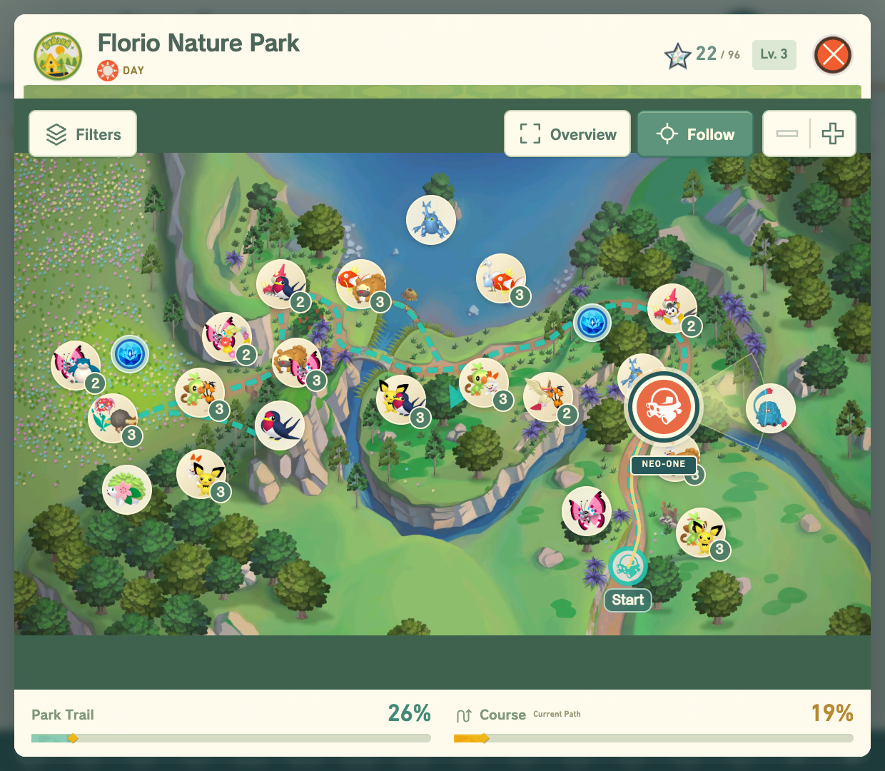
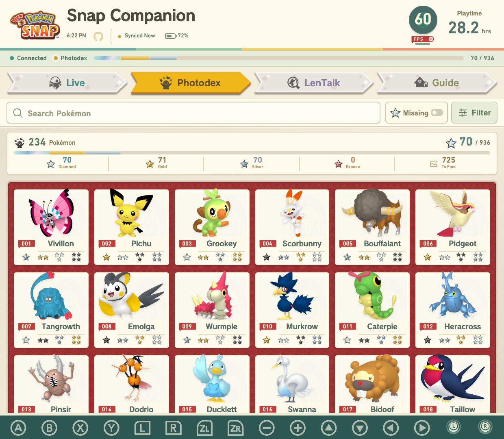
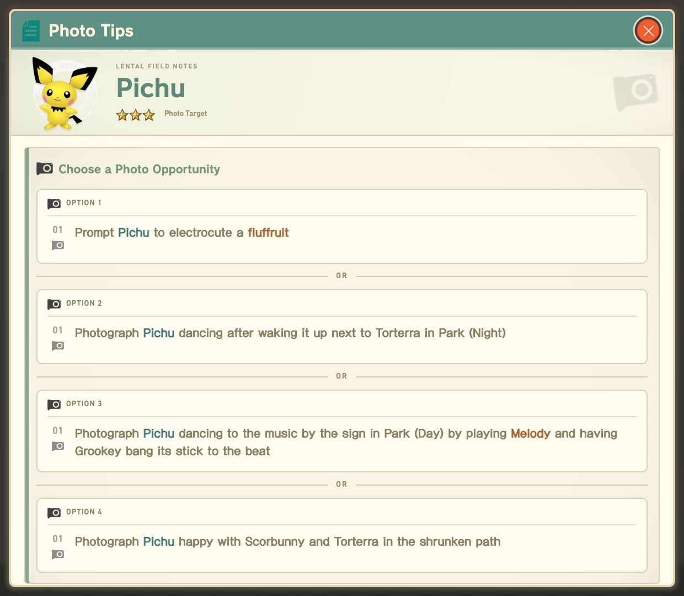
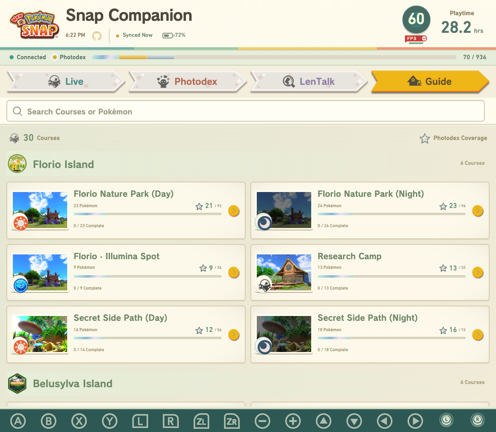

# Snap Companion

[](https://github.com/gbppimentel-dev/snap-companion/releases/latest)
[](https://github.com/gbppimentel-dev/snap-companion/actions/workflows/ci.yml)
[](LICENSE)

An offline second-screen companion for **New Pokémon Snap on AYN Thor**, running alongside Eden. Keep your Photodex, LenTalk requests, photo tips and illustrated course map on the bottom screen while playing above.

**[Download v0.5.35](https://github.com/gbppimentel-dev/snap-companion/releases/tag/v0.5.35)** · [Setup](docs/SETUP.md) · [Changes since v0.5.24](docs/releases/v0.5.35.md) · [Compatibility](docs/COMPATIBILITY.md)

The APK updates the original Snap Companion app in place. It includes its own supported read-only game-memory reader; **no separate Next app or Eden Duo mod is required**. Keep the existing app installed to preserve its data.

## What it does

| Area | Available now |
| --- | --- |
| **Live** | Current course, day/night variant and selected research level from supported game memory; photos left when available; photo suggestions, recent snapshots and course requests. |
| **Header & controls** | Available Eden-reported FPS, Cocoon-recorded Thor playtime, clock, last sync, a quiet battery icon/percentage and passive controller/stick feedback. |
| **Expandable course map** | All 30 course illustrations, 143 terrain/route assets and 1,403 reference sightings. Pan, pinch/zoom, Overview and default Follow; Pokémon, Missing Diamonds, LenTalk and Hidden modes. |
| **NEO-ONE tracking** | Matched rail position, travelled trail, named section progress, branch/rejoin-aware current-path progress and a guarded render-camera view cone where aligned. Brief handoffs show a labelled, stationary last position. |
| **Photodex** | 234 Pokémon, four official saved categories each and a 936-Diamond goal. Automatic supported records/images, compact artwork grids, course/level filters, missing-Diamond toggle and four-photo albums. |
| **Photo tips** | 58 reviewed course-specific methods plus 442 existing scoped instructions, covering 499 star categories; other categories retain general guidance. 258 hint groups show 612 distinct options with clear OR separators. |
| **LenTalk** | Illustrated request cards, supported received/completed statuses, filters, full offline solutions, reward references and optional reviewed route/setup/timing notes for 13 requests. |
| **Guide** | Courses grouped by island and day/night, encounters, collection coverage, photo-category status, forms/gender reference artwork and links into the in-app Photodex. |

Photo Selection now keeps the normal Live dashboard. The automatic Photo Selection comparison page and the grading helper are absent. Browsing reference filters never changes the game.

## What changed since the previous public release

v0.5.24 was the first public release. v0.5.35 publishes the subsequent APK work: the bundled memory reader, illustrated maps and route/camera tracking, native-asset UI refresh, redesigned collection/request/guide readers, more specific photo instructions, snapshot/import improvements, map handoff recovery and the simplified battery display.

See the [release notes](docs/releases/v0.5.35.md) and [changelog](CHANGELOG.md). The historical v0.5.24 tag, APK and release assets remain unchanged.

## Compatibility and honest limits

The checked target is **AYN Thor, Android 13, original Eden package `dev.eden.eden_emulator` (observed 0.2.1), and New Pokémon Snap 2.0.1**. The supported AYN firmware service is required. Other devices, firmware, emulator packages and game builds are unverified. English OCR remains in use for supported screen-only information; native course/level readings do not depend on reading those labels.

- Map alignment is schematic and covers **portions of 30 illustrations / 121 of 123 known rails**. Two short rails, rejected intervals and some seasonal/branch variants remain unplaced or unverified. This is not complete all-course gameplay acceptance.
- Pokémon pins are authored reference sightings across research levels, **not live Pokémon positions** or guarantees that a particular pose is currently available.
- Forest/Camp whole-course totals remain neutral where continuation data is incomplete. Fresh section readings may still work. Unknown/stale positions are not replaced by timer-based movement.
- Live target/pose recognition and ranking of ungraded photos are not implemented. Photo examples describe reference opportunities, not the location of your saved photograph.
- Saved metadata can arrive before its image. Copies refresh during supported quiet scenes. An image already black in the game save cannot be reconstructed.
- Event/fork recovery passes local route/model/browser checks; a full in-game split-path run for this latest fix was not completed. Restart, long-session, thermal and full hardware coverage remain incomplete. There is no sustained 60 FPS guarantee.

[Compatibility details](docs/COMPATIBILITY.md) · [Map model](docs/ROUTE_MAP.md) · [Hardware evidence](docs/THOR_READER_VALIDATION.md) · [Current limitations/checklist](docs/AFK_MAP_WORK.md)

## Install or update

1. Run your own compatible copy of Snap in Eden and create a normal game save.
2. Download the signed APK from [Releases](https://github.com/gbppimentel-dev/snap-companion/releases/latest) and install it **over the existing app**. Do not uninstall or clear data.
3. In Cocoon's game-shortcut options, choose **Use Companion → Snap Companion → bottom screen**.
4. Open normally. Supported live connections start automatically; respond to Android permission prompts if presented.

The package remains `dev.gbppimentel.snapcompanion` with the original signing certificate and private-data paths. [Setup and troubleshooting](docs/SETUP.md).

## Screenshots

These are current UI previews with **invented progress and simulated readings**. They contain no personal saves/photos and do not measure device performance.

<table>
  <tr>
    <td width="50%"><br>Live</td>
    <td width="50%"><br>Course map</td>
  </tr>
  <tr>
    <td width="50%"><br>Photodex</td>
    <td width="50%"><br>LenTalk</td>
  </tr>
  <tr>
    <td width="50%"><br>Photo tips</td>
    <td width="50%"><br>Guide</td>
  </tr>
</table>

## Build and contribute

Java, bundled HTML/CSS/JavaScript and a Thor-specific ARM64 reader. Prepared assets/catalogs are included; no original game archive, save or console keyset is needed to compile.

```sh
sh scripts/build-local.sh
```

Use JDK 21, Node 22+, Python 3.10+, Android platform/build-tools 36 and NDK 28.2.13676358/r28c. Set `JAVA_HOME`, `ANDROID_HOME` and optionally `ANDROID_NDK_HOME`. The script runs model, native, diagnostic and Android checks, lint and original identity/signing checks, then produces an ignored `dist/development/` APK. It does not install or publish. A build signed with another key cannot update the distributed APK.

[Building/signing/packaging](docs/BUILDING.md) · [Contributing](CONTRIBUTING.md) · [Architecture](docs/ARCHITECTURE.md) · [Privacy](docs/PRIVACY.md)

## Credits and license

Created by [gbppimentel-dev](https://github.com/gbppimentel-dev).

Original companion code/documentation use the [MIT license](LICENSE). Reused native reader/research components identify their GPL-3.0-or-later license; see [third-party notices](THIRD_PARTY_NOTICES.md). Pokémon artwork, branding, game-derived references and fonts remain third-party content and are not relicensed under MIT.

Unofficial fan companion, independent of Nintendo, The Pokémon Company, Creatures, GAME FREAK, Bandai Namco Studios, AYN, Eden and Cocoon. No companion account, Internet permission, analytics, online updater, original game archives, user saves or signing keys are included. Original game saves are not written.
