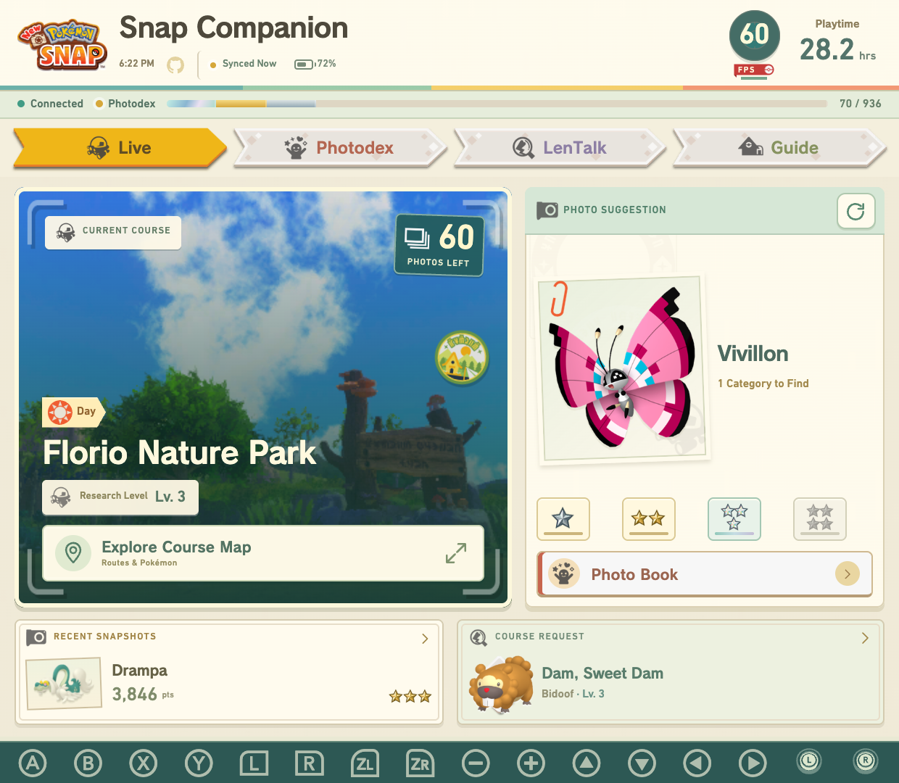
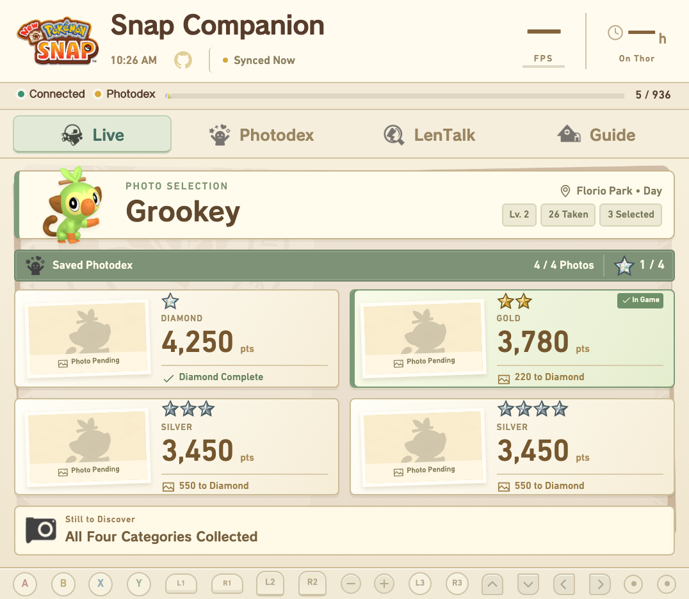

# Snap Companion

**SCN development now continues as normal APK updates to the original Snap Companion app.** The user lifted the separate-fork/freeze requirement on 2026-11-18. Future builds retain `dev.gbppimentel.snapcompanion`, the existing signing certificate, private data and established interface. No separate Next installation or mandatory Eden Duo mod is required by this delivery plan.

The current development APK is **0.5.25-dev.2 / code38**. It bundles an automatically started, read-only Thor memory reader for active course, selected level, rail distance, position and forward direction. Course/level readings feed the existing dashboard; position is internal groundwork, not a finished illustrated map. Hardware checks cover Park Day level 2, pause/movement, leaving the course the installed dashboard showing Park Night level 2, and cold reopening while paused mid-course. All-course acceptance, map calibration/expansion, Pokémon overlays and product touch shortcuts remain unfinished. Native research in [eden-duo/](eden-duo/README.md) is reused behind this APK. See [hardware validation and remaining work](docs/THOR_READER_VALIDATION.md).

Build with `scripts/build-local.sh`. It verifies original-package upgrade identity and the v0.5.24 signing certificate. Historical v0.5.24 tag, release, APK and backups remain unchanged. No automatic uninstall, data clearing, device installation or publication occurs. See [current delivery rules](docs/NEXT.md). Documentation below describes the inherited v0.5.24 feature baseline.

---

# Snap Companion

[](https://github.com/gbppimentel-dev/snap-companion/releases/latest)
[](https://github.com/gbppimentel-dev/snap-companion/actions/workflows/ci.yml)
[](LICENSE)

**a second-screen companion for New Pokémon Snap on AYN Thor**, running through Eden. keep your Photodex, LenTalk requests and course references on the bottom screen while playing above. everything runs locally, including offline.

[download the APK](https://github.com/gbppimentel-dev/snap-companion/releases/latest) · [setup](docs/SETUP.md) · [compatibility](docs/COMPATIBILITY.md) · [report a bug](https://github.com/gbppimentel-dev/snap-companion/issues/new/choose)

## what it does

- **Photodex:** automatic saved-photo registration, scores, medals and available images. track all **936 Diamond photos** across **234 Pokémon**, with compact location and missing-photo filters.
- **LenTalk:** received/completed status from supported saved records, illustrated request cards, full offline solutions and reward references.
- **photo selection:** saved category benchmarks, missing stars and points needed for Diamond alongside the currently recognized subject/category. it does not rank ungraded shots.
- **course guide:** **30 courses**, encounter references, research-level browsing and collection coverage. saved research progress stays separate from the selected level in the game.
- **live dashboard:** supported course/time/level labels, a reference suggestion and a passive controller display. clock, sync status, available emulator-reported FPS and Cocoon-recorded Thor playtime sit in the header.
- **offline references:** four star-category tips per Pokémon, named forms/gender reference art, indexed search and course-example references.
- **credits:** a small header button opens the creator and contributor acknowledgements.

**automation limits:** current-course/level recognition depends on supported English screen labels. opening mid-course can leave the context unknown. route position, live visual Pokémon/pose recognition and ungraded-photo ranking are not implemented. [compatibility](docs/COMPATIBILITY.md) separates working features from unverified behavior.

**offline:** no Internet permission, companion account, analytics or online updater.

## screenshots

The companion runs below the game. These are local UI previews with **invented example progress**, not personal save captures or performance measurements.

<table>
  <tr>
    <td width="50%" valign="top"><a href="docs/images/overview.png"></a><br><b>while exploring</b><br>course context and a compact reference suggestion.</td>
    <td width="50%" valign="top"><a href="docs/images/photodex.png"></a><br><b>tracking the Photodex</b><br>four categories, medal progress and location filters.</td>
  </tr>
  <tr>
    <td width="50%" valign="top"><a href="docs/images/lentalk.png"></a><br><b>checking LenTalk</b><br>request status and full solutions inside each postcard.</td>
    <td width="50%" valign="top"><a href="docs/images/photo-selection.png"></a><br><b>choosing photos</b><br>saved benchmarks and missing categories before submission.</td>
  </tr>
</table>

## install

1. **prepare Snap in Eden.** use your own compatible copy of New Pokémon Snap. open the game and create a save normally.
2. **install the companion.** download `SnapCompanion-v0.5.24.apk` from [releases](https://github.com/gbppimentel-dev/snap-companion/releases/latest). install over an existing copy to preserve its data.
3. **pair it in Cocoon.** open the game's launch-shortcut options, choose **Use Companion**, select **Snap Companion**, and choose the bottom screen.
4. **start playing.** on the supported Thor environment, opening the companion starts its connection automatically. follow any Android permission prompts if presented.

The direct link targets the original Eden package, `dev.eden.eden_emulator`. Other emulator packages and firmware builds are unverified. The app depends on the supported AYN firmware service; installing the APK does not make it a generic Android companion.

[setup and maintenance](docs/SETUP.md) covers pairing, updates and troubleshooting.

## tested scope

| component | supported / checked scope |
| --- | --- |
| **device** | AYN Thor; broader Android devices unverified |
| **Android** | physical development environment: Android 13; package minimum API 30 |
| **emulator** | original Eden package; exact public version matrix not yet qualified |
| **game data** | New Pokémon Snap 2.0.1 schemas and factual tables |
| **screen text** | supported English layouts; other languages unverified |
| **public release** | 0.5.24 adds credits to the 0.5.23 core; local checks passed; the credits APK has not had a new physical-device acceptance run |

There is no claim of universal 60 FPS, complete live-course coverage or recovery of photographs already saved as black. The [compatibility matrix](docs/COMPATIBILITY.md) records these limits.

## docs

- **[setup & maintenance](docs/SETUP.md):** installation, pairing and updates.
- **[compatibility](docs/COMPATIBILITY.md):** supported sources and remaining limitations.
- **[how it works](docs/ARCHITECTURE.md):** saved data, screen observations and the local bridge.
- **[privacy](docs/PRIVACY.md):** what the app reads and stores.
- **[building](docs/BUILDING.md):** source builds, checks and signing.
- **[release notes](docs/releases/v0.5.24.md):** downloads, changes and validation scope.

## building

The app uses Java and a bundled HTML/CSS/JavaScript interface. Prepared UI/reference assets are included; no original game archives, extraction toolchain or user save is needed to compile it.

```sh
node --test tests/ui-model.cjs
python3 -m unittest discover -s diagnostics -p 'test_*.py'
python3 tests/publication-audit.py
./gradlew :app:testDebugUnitTest :app:assembleDebug
```

**toolchain:** JDK 21, Node 22 or newer, Python 3.10 or newer, Android platform 36 and build-tools 36.0.0. Set `JAVA_HOME` and `ANDROID_HOME`. Gradle downloads its declared build/test dependencies.

Local builds use a local development signing key. Use the published APK to update an installed release. [build instructions](docs/BUILDING.md) · [contributing](CONTRIBUTING.md) · [release history](CHANGELOG.md)

## credits & license

**made by:** [gbppimentel-dev](https://github.com/gbppimentel-dev).

Original companion code and documentation are under the [MIT license](LICENSE). Pokémon game content, branding, reference artwork, game-derived text and fonts remain third-party material and are not relicensed under MIT. Source acknowledgements and bundled-library licenses are in [third-party notices](THIRD_PARTY_NOTICES.md).

This is an unofficial fan companion, independent of Nintendo, The Pokémon Company, Creatures, GAME FREAK, Bandai Namco Studios, AYN, Eden and Cocoon. You need your own compatible game.
